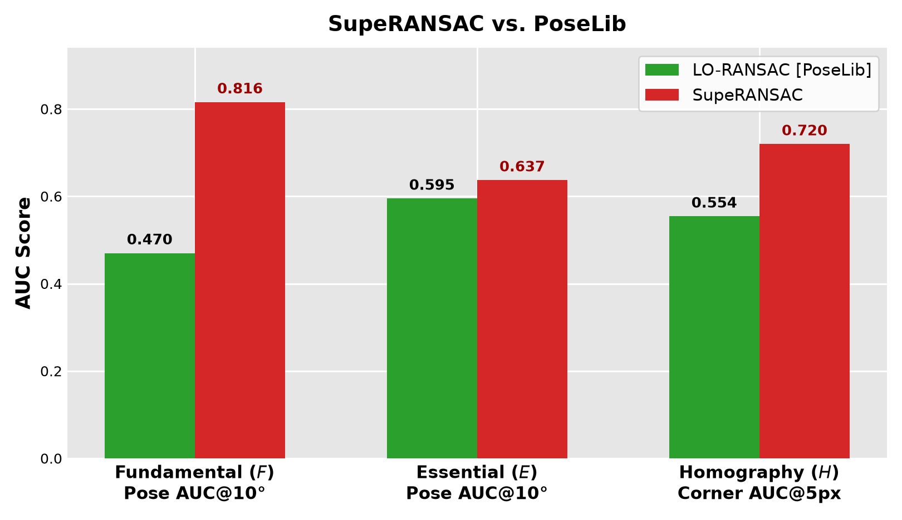

# SupeRANSAC: One RANSAC to Rule them All ([Arxiv Paper](https://arxiv.org/abs/2506.04803))

## About

SupeRANSAC is a Python library that provides bindings for an advanced RANSAC C++ implementation using `pybind11`. 
It supports a wide variety of sampling, scoring, local optimization, degeneracy handling, and inlier selection techniques for robust model estimation tasks.
It provides estimators for **homography**, **essential matrix**, **fundamental matrix**, **6D rigid transformation**, and **6D absolute pose** estimation.

## Installation

Clone the repository and its submodules:
```bash
git clone git@github.com:danini/superansac.git
```

Make sure that you have the necessary OpenCV and Eigen libraries installed:
```bash
sudo apt-get update
sudo apt-get install libopencv-dev libopencv-contrib-dev libarpack++2-dev libarpack2-dev libsuperlu-dev cmake build-essential libboost-all-dev libeigen3-dev
```

Install SupeRANSAC by running:
```bash
pip install .
```

---

# Results

## 1. Benchmark Overview: `SupeRANSAC` vs. `PoseLib`

Using the default `RANSACSettings()` out of the box, `SupeRANSAC` outperforms `PoseLib` across fundamental matrix, essential matrix, and homography estimation, and achieves `0.8496` $\text{AUC}@(5^\circ, 10\text{cm})$ on 6D rigid pose estimation:

<p align="center">
  
</p>

| Problem (Dataset Size) | Primary Metric | `PoseLib` | **`SupeRANSAC`** | Gain vs. `PoseLib` |
| :--- | :--- | :---: | :---: | :---: |
| **Fundamental Matrix ($F$, 120 pairs)** | Pose $\text{AUC}@10^\circ$ | `0.4699` | **`0.8155`** | **`+34.56 pt`** |
| **Essential Matrix ($E$, 100 pairs)** | Pose $\text{AUC}@10^\circ$ | `0.5949` | **`0.6369`** | **`+4.20 pt`** |
| **Homography ($H$, 100 pairs)** | Corner $\text{AUC}@5\text{px}$ | `0.5541` | **`0.7196`** | **`+16.55 pt`** |
| **Rigid 6D Pose ($SE(3)$, 120 pairs)** | Pose $\text{AUC}@(5^\circ, 10\text{cm})$ | N/A | **`0.8496`** | N/A |

---

## 2. Speed–Accuracy Trade-Off: `SupeRANSAC` vs. `PoseLib`

Below, the speed–accuracy trade-off curves (`AUC@10°` for Essential and Fundamental matrix, `Corner AUC@5px` for Homography) are shown for **SuperPoint/DISK + LightGlue** (top row), **RoMa** (middle row), and **LoMa** (bottom row) across **Essential Matrix** (left), **Fundamental Matrix** (middle), and **Homography** (right) estimation:

<table align="center">
  <tr>
    <td align="center"></td>
    <td align="center"></td>
    <td align="center"></td>
  </tr>
  <tr>
    <td align="center"></td>
    <td align="center"></td>
    <td align="center"></td>
  </tr>
  <tr>
    <td align="center"></td>
    <td align="center"></td>
    <td align="center"></td>
  </tr>
  <tr>
    <td align="center"><b>Essential Matrix</b></td>
    <td align="center"><b>Fundamental Matrix</b></td>
    <td align="center"><b>Homography</b></td>
  </tr>
</table>

---

## 3. Multi-Detector Evaluation Across 7 Feature Matchers (including `LoMa`)

Evaluated across 56 real image pairs (`PhotoTourism`, `ScanNet`, and `ExtremeView`) with **7 modern and classical feature detectors/matchers**: **[LoMa](https://github.com/davnords/LoMa)** (*ECCV 2026 Oral: Local Feature Matching Revisited*), **[RoMa](https://github.com/Parskatt/RoMa)**, **LoFTR**, **DISK + LightGlue**, **RootSIFT**, **SIFT**, and **ORB**.

<table align="center">
  <tr>
    <td align="center"></td>
    <td align="center"></td>
  </tr>
  <tr>
    <td align="center" colspan="2"></td>
  </tr>
</table>

### Fundamental Matrix ($F$, Pose $\text{AUC}@10^\circ$)
`SupeRANSAC` outperforms `PoseLib` across **all 7 feature matchers**:

| Detector / Matcher | `PoseLib` | **`SupeRANSAC`** | Gain vs. `PoseLib` |
| :--- | :---: | :---: | :---: |
| **LoMa** | `0.5685` | **`0.6032`** | **`+3.47 pt`** |
| **RoMa** | `0.5454` | **`0.5612`** | **`+1.57 pt`** |
| **LoFTR** | `0.5506` | **`0.5621`** | **`+1.15 pt`** |
| **DISK + LightGlue** | `0.5285` | **`0.5302`** | **`+0.16 pt`** |
| **RootSIFT** | `0.5498` | **`0.5528`** | **`+0.31 pt`** |
| **SIFT** | `0.4809` | **`0.5124`** | **`+3.15 pt`** |
| **ORB** | `0.2316` | **`0.3231`** | **`+9.15 pt`** |

### Essential Matrix ($E$, Pose $\text{AUC}@10^\circ$)
`SupeRANSAC` outperforms `PoseLib` across **all 7 feature matchers**:

| Detector / Matcher | `PoseLib` | **`SupeRANSAC`** | Gain vs. `PoseLib` |
| :--- | :---: | :---: | :---: |
| **LoMa** | `0.3365` | **`0.5107`** | **`+17.42 pt`** |
| **RoMa** | `0.3402` | **`0.5408`** | **`+20.05 pt`** |
| **LoFTR** | `0.3245` | **`0.4426`** | **`+11.81 pt`** |
| **DISK + LightGlue** | `0.2706` | **`0.4450`** | **`+17.44 pt`** |
| **RootSIFT** | `0.3090` | **`0.4394`** | **`+13.04 pt`** |
| **SIFT** | `0.3074` | **`0.3567`** | **`+4.92 pt`** |
| **ORB** | `0.2488` | **`0.2514`** | **`+0.26 pt`** |

### Homography Matrix ($H$, Corner $\text{AUC}@5\text{px}$)

| Detector / Matcher | `PoseLib` | **`SupeRANSAC`** | Gain vs. `PoseLib` |
| :--- | :---: | :---: | :---: |
| **LoMa** | `0.7005` | **`0.7043`** | **`+0.38 pt`** |
| **RoMa** | **`0.6965`** | `0.6814` | `-1.52 pt` |
| **LoFTR** | `0.5574` | **`0.5600`** | **`+0.26 pt`** |
| **DISK + LightGlue** | **`0.5285`** | `0.5267` | `-0.18 pt` |
| **RootSIFT** | `0.4528` | **`0.5373`** | **`+8.45 pt`** |
| **SIFT** | `0.4554` | **`0.5359`** | **`+8.05 pt`** |
| **ORB** | `0.3725` | **`0.3888`** | **`+1.63 pt`** |

---

## 4. Absolute Pose & 3D Rigid Registration

Below, absolute pose (from 2D-3D correspondences) and rigid transformation (from 3D-3D matches) estimation results are shown. 
For absolute pose estimation, we integrated SupeRANSAC into the `hloc` library.
For rigid transformation estimation, we employ GeoTransformer features. 

<table align="center">
  <tr>
    <td align="center"></td>
    <td align="center"></td>
  </tr>
  <tr>
    <td align="center"><b>Absolute Pose with hloc</b></td>
    <td align="center"><b>Rigid transform with GeoTransformer</b></td>
  </tr>
</table>

---

# Jupyter Notebook Examples

- **Homography Fitting with SuperPoint + LightGlue Matches**  
  Example available at: [notebook](examples/example_homography_fitting_splg.ipynb)

- **Homography Fitting with RoMA Matches**  
  Example available at: [notebook](examples/example_homography_fitting_roma.ipynb)

- **Fundamental Matrix Fitting with SuperPoint + LightGlue Matches**  
  Example available at: [notebook](examples/example_fundamental_matrix_fitting_splg.ipynb)

- **Fundamental Matrix Fitting with RoMA Matches**  
  Example available at: [notebook](examples/example_fundamental_matrix_fitting_roma.ipynb)

- **Essential Matrix Fitting with SuperPoint + LightGlue Matches**  
  Example available at: [notebook](examples/example_essential_matrix_fitting_splg.ipynb)

- **Essential Matrix Fitting with RoMA Matches**  
  Example available at: [notebook](examples/example_essential_matrix_fitting_roma.ipynb)

- **Absolute Pose Estimation**  
  Example available at: [notebook](examples/example_absolute_pose_fitting.ipynb)

- **6D Rigid Transformation Estimation**  
  Example available at: [notebook](examples/example_rigid_transform_fitting.ipynb)

---

## Usage

The library provides several model estimation functions and settings that allow customization of the RANSAC pipeline. `RANSACSettings()` is pre-configured with the best defaults for all estimators.

### Importing the Library

```python
import numpy as np
import pysuperansac
from pysuperansac import (
    ScoringType,
    SamplerType,
    LocalOptimizationType,
    InlierSelectorType,
    NeighborhoodType,
    CameraType,
    RANSACSettings,
)
```

### Example: Estimate a Homography, Fundamental, or Essential Matrix

```python
# Correspondences as an (N, 4) float64 array: [x1, y1, x2, y2], sorted by descending confidence
correspondences = np.array([
    [x1, y1, x2, y2],
    [x3, y3, x4, y4],
    # ...
], dtype=np.float64)
probabilities = np.ones(len(correspondences), dtype=np.float64)
image_sizes = [height1, width1, height2, width2]

# Default RANSACSettings() uses the best configuration automatically
config = RANSACSettings()

# Estimate Homography
H, inliers, score, iterations = pysuperansac.estimateHomography(
    correspondences, image_sizes, probabilities, config=config
)

# Estimate Fundamental Matrix
F, inliers, score, iterations = pysuperansac.estimateFundamentalMatrix(
    correspondences, image_sizes, probabilities, config=config
)

# Estimate Essential Matrix
E, inliers, score, iterations = pysuperansac.estimateEssentialMatrix(
    correspondences, K1, K2, image_sizes, probabilities, config=config
)
```

### Supported Estimation Functions

#### 1. Homography Estimation
- **Function**: `pysuperansac.estimateHomography(correspondences, image_sizes, probabilities=[], config=RANSACSettings())`
- **Description**: Estimates a $3 \times 3$ homography matrix from 2D-2D point correspondences.
- **Parameters**:
  - `correspondences`: `(N, 4)` `np.ndarray` (`[x1, y1, x2, y2]`).
  - `image_sizes`: `[height_src, width_src, height_dst, width_dst]`.
  - `probabilities` *(optional)*: Length-`N` list/array of prior match confidences.
  - `config`: An instance of `RANSACSettings`.

#### 2. Fundamental Matrix Estimation
- **Function**: `pysuperansac.estimateFundamentalMatrix(correspondences, image_sizes, probabilities=[], config=RANSACSettings())`
- **Description**: Estimates a $3 \times 3$ fundamental matrix from 2D-2D point correspondences with DEGENSAC and Plane-and-Parallax support.
- **Parameters**:
  - `correspondences`: `(N, 4)` `np.ndarray` (`[x1, y1, x2, y2]`).
  - `image_sizes`: `[height_src, width_src, height_dst, width_dst]`.
  - `probabilities` *(optional)*: Length-`N` list/array of prior match confidences.
  - `config`: An instance of `RANSACSettings`.

#### 3. Essential Matrix Estimation
- **Function**: `pysuperansac.estimateEssentialMatrix(correspondences, intrinsics_src, intrinsics_dst, image_sizes, probabilities=[], config=RANSACSettings())`
- **Description**: Estimates a $3 \times 3$ essential matrix using 2D-2D point correspondences and camera intrinsic matrices.
- **Parameters**:
  - `correspondences`: `(N, 4)` `np.ndarray` (`[x1, y1, x2, y2]`).
  - `intrinsics_src`: $3 \times 3$ source camera intrinsic matrix.
  - `intrinsics_dst`: $3 \times 3$ destination camera intrinsic matrix.
  - `image_sizes`: `[height_src, width_src, height_dst, width_dst]`.
  - `probabilities` *(optional)*: Length-`N` list/array of prior match confidences.
  - `config`: An instance of `RANSACSettings`.

#### 4. Rigid Transformation Estimation
- **Function**: `pysuperansac.estimateRigidTransform(correspondences, bounding_box_sizes, probabilities=[], config=RANSACSettings())`
- **Description**: Estimates a $4 \times 4$ 6D rigid transformation matrix from 3D-3D point correspondences.
- **Parameters**:
  - `correspondences`: `(N, 6)` `np.ndarray` (`[X1, Y1, Z1, X2, Y2, Z2]`).
  - `bounding_box_sizes`: `[max_x1, max_y1, max_z1, max_x2, max_y2, max_z2]`.
  - `probabilities` *(optional)*: Length-`N` list/array of prior match confidences.
  - `config`: An instance of `RANSACSettings`.

#### 5. Absolute Pose Estimation
- **Function**: `pysuperansac.estimateAbsolutePose(correspondences, camera_type, camera_params, bounding_box, probabilities=[], config=RANSACSettings())`
- **Description**: Estimates the 6D absolute pose $(R, t)$ of a camera from 2D-3D correspondences.
- **Parameters**:
  - `correspondences`: `(N, 5)` `np.ndarray` (`[u, v, X, Y, Z]`).
  - `camera_type`: Type of the camera (e.g., `CameraType.SimpleRadial`, `CameraType.SimplePinhole`).
  - `camera_params`: Camera intrinsic/distortion parameters.
  - `bounding_box`: `[height, width, max_X, max_Y, max_Z]`.
  - `probabilities` *(optional)*: Length-`N` list/array of prior match confidences.
  - `config`: An instance of `RANSACSettings`.

### Advanced Configuration: `RANSACSettings`

The `RANSACSettings` class provides fine-grained control over the RANSAC pipeline (shown below with the default values):

```python
config = RANSACSettings()
config.min_iterations = 1000
config.max_iterations = 5000
config.inlier_threshold = 1.5
config.confidence = 0.999999
config.scoring = ScoringType.MAGSAC
config.sampler = SamplerType.PROSAC
config.local_optimization = LocalOptimizationType.GCRANSAC
config.final_optimization = LocalOptimizationType.LSQ
config.neighborhood = NeighborhoodType.Grid
```

### Enumerations and Their Values

**Scoring Types**
- `ScoringType.RANSAC`
- `ScoringType.MSAC`
- `ScoringType.MAGSAC`
- `ScoringType.ACRANSAC`
- `ScoringType.GRID`

**Sampler Types**
- `SamplerType.Uniform`
- `SamplerType.PROSAC`
- `SamplerType.NAPSAC`
- `SamplerType.ProgressiveNAPSAC`
- `SamplerType.ImportanceSampler`
- `SamplerType.ARSampler`

**Local Optimization Types**
- `LocalOptimizationType.Nothing`
- `LocalOptimizationType.LSQ`
- `LocalOptimizationType.IRLS`
- `LocalOptimizationType.NestedRANSAC`
- `LocalOptimizationType.GCRANSAC`
- `LocalOptimizationType.IteratedLM`

**Neighborhood Types**
- `NeighborhoodType.Grid`
- `NeighborhoodType.FLANN_KNN`
- `NeighborhoodType.FLANN_Radius`
- `NeighborhoodType.BruteForce`

**Camera Types**
- `CameraType.SimpleRadial`
- `CameraType.SimplePinhole`

---

## Evaluation - Python

The testing scripts for SupeRANSAC are located in `tests/`:
- Fundamental matrix: `python tests/fundamental_matrix/tester_superansac.py --features LoMa`
- Essential matrix: `python tests/essential_matrix/tester_superansac.py --features LoMa`
- Homography matrix: `python tests/homography/tester_superansac.py --features LoMa`
- Rigid 6D transformation: `python tests/rigid_transformation/tester_superansac.py`

Supported `--features` options include `LoMa`, `RoMa`, `LightGlue`, `LoFTR`, `RootSIFT`, `SIFT`, and `ORB`.

### Install Feature Detectors

To use **LoMa** ([ECCV 2026 Oral] *LoMa: Local Feature Matching Revisited*):
```bash
git clone https://github.com/davnords/LoMa.git && cd LoMa
pip install -e .
```

To use **SuperPoint / DISK + LightGlue** or **LoFTR** features, install `kornia` / `LightGlue`:
```bash
pip install kornia
git clone https://github.com/cvg/LightGlue.git && cd LightGlue
python -m pip install -e .
```

To use **RoMa** features:
```bash
git clone https://github.com/Parskatt/RoMa && cd RoMa
pip install -e .
```

### Evaluation on the PhotoTourism dataset
Download the data from the CVPR tutorial "RANSAC in 2020":
```bash
wget http://cmp.felk.cvut.cz/~mishkdmy/CVPR-RANSAC-Tutorial-2020/RANSAC-Tutorial-Data-EF.tar
tar -xf RANSAC-Tutorial-Data-EF.tar
```

Then run the notebook `examples/relative_pose_evaluation_phototourism.ipynb`.

### Evaluation on the ScanNet dataset
Download the data from the test set for relative pose estimation used in SuperGlue (~250Mb for 1500 image pairs only):
```bash
wget https://www.polybox.ethz.ch/index.php/s/lAZyxm62WUh27Zl/download
unzip ScanNet_test.zip -d <path to extract the ScanNet test set>
```

Then run the notebook `examples/relative_pose_evaluation_scannet.ipynb`.

### Evaluation on the 7Scenes dataset
Download the [7Scenes dataset](https://www.microsoft.com/en-us/research/project/rgb-d-dataset-7-scenes/) and put it where it suits you. You can also only download one scene and later specify this scene in the dataloader constructor.

Then run the script `runners/run_7scenes.py`.

### Evaluation on the ETH3D dataset
Download the [ETH3D dataset](https://www.eth3d.net/datasets) (training split of the high-res multi-view, undistorted images + GT extrinsics & intrinsics should be enough) and put it where it suits you. The input argument `downsize_factor` can be used to downscale the images, because they can be quite large otherwise.

Then run the script `runners/run_eth3d.py`.

### Evaluation on the LaMAR dataset
Download the [CAB scene of the LaMAR dataset](https://cvg-data.inf.ethz.ch/lamar/CAB.zip), and unzip it to your favourite location. Note that we only use the images in `CAB/sessions/query_val_hololens`.

### Evaluation on the KITTI dataset
Download the [KITTI odometry dataset](https://www.cvlibs.net/datasets/kitti/eval_odometry.php) (grayscale images and poses), and unzip them to your favourite location.

