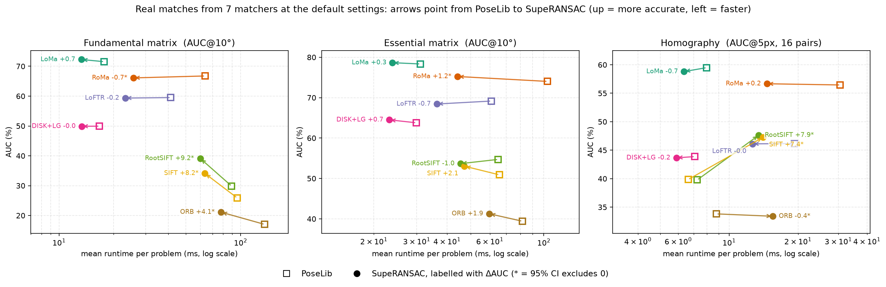
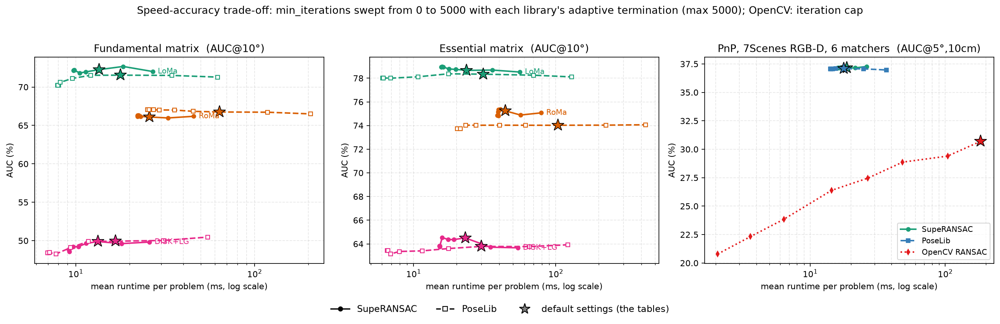
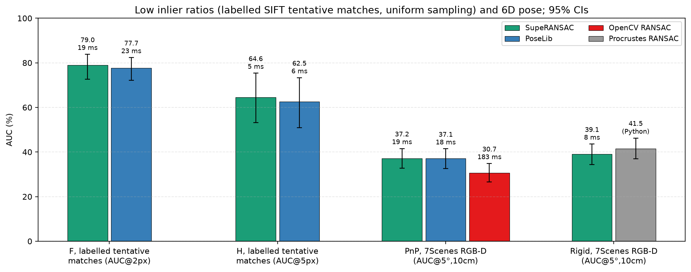

# SupeRANSAC: One RANSAC to Rule them All ([Arxiv Paper](https://arxiv.org/abs/2506.04803))

## About

SupeRANSAC is a Python library that provides bindings for an advanced RANSAC C++ implementation using `pybind11`. 
It supports a wide variety of sampling, scoring, local optimization, degeneracy handling, and inlier selection techniques for robust model estimation tasks.
It provides estimators for **homography**, **essential matrix**, **fundamental matrix**, **6D rigid transformation**, and **6D absolute pose** estimation.

## Installation

Clone the repository and its submodules:
```bash
git clone git@github.com:danini/superansac.git
```

Make sure that you have the necessary OpenCV and Eigen libraries installed:
```bash
sudo apt-get update
sudo apt-get install libopencv-dev libopencv-contrib-dev libarpack++2-dev libarpack2-dev libsuperlu-dev cmake build-essential libboost-all-dev libeigen3-dev
```

Install SupeRANSAC by running:
```bash
pip install .
```

---

# Results

All numbers compare **SupeRANSAC with its default `RANSACSettings()`** against **PoseLib 2.0.5** (and, for 6D problems, OpenCV and a plain Procrustes RANSAC) under one protocol:

* **Real inputs only.** The correspondences are the unmodified output of each matcher, or the original labelled tentative matches shipped with the classic datasets. Nothing is filtered against the ground truth, no outliers are injected, no confidence scores are synthesised. (Synthetic 6D outlier sweeps are reported separately in [RESULTS.md](RESULTS.md).)
* **Real ground truth only.** PhotoTourism / ETH3D / 7Scenes poses and calibrations, Homogr / EVD homographies and kusvod2 / AdelaideRMF inlier labels all come from the datasets.
* **Identical inputs, thresholds and termination for every method**: the same correspondence array in the same order; 1.5 px ($F$, $E$), 4.0 px ($H$), 3.5 px (PnP), 5 cm (rigid); every method runs its own adaptive termination (confidence 0.9999) within 1000–5000 iterations; PROSAC for every method wherever the matches are ordered by matcher confidence, uniform sampling for every method where they are not. SupeRANSAC additionally receives the confidence values themselves (PoseLib's API has no input for them) and uses them as weights in its local optimisation and, for $F$ and $E$, in its final refinement.
* **Frozen pair lists.** The 300 calibrated pairs are listed in `tests/datasets/pairs/calibrated_pairs.json`, so anyone with the datasets evaluates exactly the same pairs.
* **No input-statistics-dependent switches**: every default is the same for every dataset and matcher.
* **Uncertainty and timing.** Δ = SupeRANSAC − baseline in AUC points with a 95% paired bootstrap confidence interval over image pairs (over scenes for the labelled sets). Runtimes are means per problem of single-threaded calls, measured with up to 8 concurrent benchmark processes.

<p align="center"></p>

| Task | Data | Metric | PoseLib | SupeRANSAC | Δ [95% CI] | ms PoseLib / SupeRANSAC |
|---|---|---|---:|---:|---:|---:|
| $F$, learned matchers (LoMa, RoMa, LoFTR, DISK+LG) | 300 calibrated pairs | AUC@10° | 61.9 | 61.9 | -0.0 [-0.8, +0.6] | 35 / 19 |
| $F$, classical matchers (RootSIFT, SIFT, ORB) | 300 calibrated pairs | AUC@10° | 24.3 | 31.5 | +7.2 [+5.4, +9.2] | 107 / 67 |
| $E$, learned matchers (LoMa, RoMa, LoFTR, DISK+LG) | 300 calibrated pairs | AUC@10° | 71.3 | 71.7 | +0.4 [-0.3, +1.0] | 56 / 32 |
| $E$, classical matchers (RootSIFT, SIFT, ORB) | 300 calibrated pairs | AUC@10° | 48.3 | 49.3 | +1.0 [-0.5, +2.5] | 71 / 51 |
| $H$, learned matchers (LoMa, RoMa, LoFTR, DISK+LG) | 16 Homogr + EVD pairs | AUC@5px | 51.5 | 51.3 | -0.2 [-0.7, +0.4] | 16 / 10 |
| $H$, classical matchers (RootSIFT, SIFT, ORB) | 16 Homogr + EVD pairs | AUC@5px | 37.8 | 42.8 | +5.0 [-0.1, +12.1] | 8 / 14 |
| $F$, labelled SIFT tentative matches | 30 scenes × 5 | AUC@2px | 77.7 | 79.0 | +1.2 [-2.3, +4.6] | 23 / 19 |
| $H$, labelled SIFT tentative matches | 35 scenes × 5 | AUC@5px | 62.5 | 64.6 | +2.1 [-1.6, +7.3] | 6 / 5 |
| PnP, 6 matchers | 600 7Scenes RGB-D problems | AUC@(5°,10cm) | 37.1 | 37.2 | +0.1 [-0.8, +1.0] | 18 / 19 |
| Rigid, 6 matchers (baseline: Procrustes RANSAC) | 599 7Scenes RGB-D problems | AUC@(5°,10cm) | 41.5 | 39.1 | -2.5 [-4.0, -1.1] | Python / 8 |

**In short.**
* On matches from **learned matchers** (LoMa, RoMa, LoFTR, DISK+LightGlue) the two libraries are close: averaged over the four matchers every confidence interval contains zero. Per matcher, SupeRANSAC is significantly ahead on $E$ with RoMa and significantly behind on $F$ with RoMa (Figure above). At the default settings SupeRANSAC is faster on $F$, $E$ and $H$.
* On **classical matchers** (RootSIFT, SIFT, ORB; typically 10–40 % inliers) SupeRANSAC is clearly more accurate on $F$ and on $H$ with RootSIFT / SIFT, and faster on $F$ and $E$; on $H$ it is slower (14 vs 8 ms).
* On the **labelled tentative matches** (high outlier ratios, no confidence order) it is ahead on both $F$ and $H$, inside the wide scene-level intervals of 30–35 scenes.
* **PnP**: a tie with PoseLib, clearly ahead of OpenCV. **Rigid registration**: the Procrustes RANSAC baseline is more accurate; its runtime is not comparable because it is written in Python.

### Speed–accuracy trade-off

<p align="center"></p>

`min_iterations` is swept from 0 to 5000 while every library keeps its own adaptive termination (at most 5000 iterations); OpenCV has no minimum, so its iteration cap is swept instead. The ★ on each curve is the default configuration used in the tables. The accuracy of both libraries is nearly flat across budgets; which one is faster depends on the budget. At the default (1000 minimum iterations, which is also PoseLib's default) and above, SupeRANSAC is faster ($F$: 13–26 vs 17–64 ms, $E$: 23–44 vs 30–103 ms over LoMa / RoMa / DISK+LG). When both may stop as soon as they are confident (`min_iterations = 0`), PoseLib is faster on $E$ (6–20 vs 15–39 ms) and on $F$ with LoMa / DISK+LG, because SupeRANSAC has a fixed per-call cost (local optimisation of the top candidates and the final robust bundle). On PnP the two curves coincide (AUC 37.0–37.3 between 14 and 37 ms); OpenCV reaches 30.7 at 183 ms.

### Low inlier ratios and 6D pose

<p align="center"></p>

Per-dataset and per-matcher tables, the sweep data and the dataset descriptions are in **[RESULTS.md](RESULTS.md)**. To reproduce everything (results go to `data/`, figures to `assets/`, tables to `RESULTS.md`):

```bash
python tests/download_datasets.py                                 # PhotoTourism, ETH3D, 7Scenes, kusvod2/AdelaideRMF/Homogr/EVD
python tests/test_relative_pose.py --problem all --features all   # F, E on 300 pairs (LoMa / RoMa / DISK+LG) + speed-accuracy sweeps
python tests/test_homography.py --features all                    # H on Homogr + EVD
python tests/test_detectors.py --problem all                      # F, E, H with 7 matchers
python tests/test_classic_labelled.py                             # labelled tentative matches
python tests/test_6d_pose.py --problem all                        # PnP and rigid registration (+ PnP sweep)
python tests/make_readme_figures.py && python tests/make_readme_tables.py
```

All defaults are data-independent and were chosen on a separate development split (`tests/datasets/pairs/calibrated_pairs_dev.json`, 600 pairs disjoint from the 300 test pairs; ablations in `tests/ablations/`, harness `tests/dev_ablate.py` with paired bootstrap confidence intervals). The final defaults of every problem were evaluated once on the test split. One choice was prompted by a test result: an intermediate run showed $F$ slightly worse with the dense matchers, after which the $F$ final-bundle weighting was re-selected on the development split. The confidence-weighted final refinement and the skipping of near-duplicate top-K candidates for $F$ and $E$ (`final_bundle_confidence_weights`, `local_optimization_duplicate_overlap`) were selected on the development split and evaluated once on the test split.

---

# Jupyter Notebook Examples

- **Homography Fitting with SuperPoint + LightGlue Matches**  
  Example available at: [notebook](examples/example_homography_fitting_splg.ipynb)

- **Homography Fitting with RoMA Matches**  
  Example available at: [notebook](examples/example_homography_fitting_roma.ipynb)

- **Fundamental Matrix Fitting with SuperPoint + LightGlue Matches**  
  Example available at: [notebook](examples/example_fundamental_matrix_fitting_splg.ipynb)

- **Fundamental Matrix Fitting with RoMA Matches**  
  Example available at: [notebook](examples/example_fundamental_matrix_fitting_roma.ipynb)

- **Essential Matrix Fitting with SuperPoint + LightGlue Matches**  
  Example available at: [notebook](examples/example_essential_matrix_fitting_splg.ipynb)

- **Essential Matrix Fitting with RoMA Matches**  
  Example available at: [notebook](examples/example_essential_matrix_fitting_roma.ipynb)

- **Absolute Pose Estimation**  
  Example available at: [notebook](examples/example_absolute_pose_fitting.ipynb)

- **6D Rigid Transformation Estimation**  
  Example available at: [notebook](examples/example_rigid_transform_fitting.ipynb)

---

## Usage

The library provides several model estimation functions and settings that allow customization of the RANSAC pipeline. `RANSACSettings()` is pre-configured with the best defaults for all estimators.

### Importing the Library

```python
import numpy as np
import pysuperansac
from pysuperansac import (
    ScoringType,
    SamplerType,
    LocalOptimizationType,
    InlierSelectorType,
    NeighborhoodType,
    CameraType,
    RANSACSettings,
)
```

### Example: Estimate a Homography, Fundamental, or Essential Matrix

```python
# Correspondences as an (N, 4) float64 array: [x1, y1, x2, y2], sorted by descending confidence
correspondences = np.array([
    [x1, y1, x2, y2],
    [x3, y3, x4, y4],
    # ...
], dtype=np.float64)
probabilities = np.ones(len(correspondences), dtype=np.float64)
image_sizes = [height1, width1, height2, width2]

# Default RANSACSettings() uses the best configuration automatically
config = RANSACSettings()

# Estimate Homography
H, inliers, score, iterations = pysuperansac.estimateHomography(
    correspondences, image_sizes, probabilities, config=config
)

# Estimate Fundamental Matrix
F, inliers, score, iterations = pysuperansac.estimateFundamentalMatrix(
    correspondences, image_sizes, probabilities, config=config
)

# Estimate Essential Matrix
E, inliers, score, iterations = pysuperansac.estimateEssentialMatrix(
    correspondences, K1, K2, image_sizes, probabilities, config=config
)
```

### Supported Estimation Functions

#### 1. Homography Estimation
- **Function**: `pysuperansac.estimateHomography(correspondences, image_sizes, probabilities=[], config=RANSACSettings())`
- **Description**: Estimates a $3 \times 3$ homography matrix from 2D-2D point correspondences.
- **Parameters**:
  - `correspondences`: `(N, 4)` `np.ndarray` (`[x1, y1, x2, y2]`).
  - `image_sizes`: `[height_src, width_src, height_dst, width_dst]`.
  - `probabilities` *(optional)*: Length-`N` list/array of prior match confidences.
  - `config`: An instance of `RANSACSettings`.

#### 2. Fundamental Matrix Estimation
- **Function**: `pysuperansac.estimateFundamentalMatrix(correspondences, image_sizes, probabilities=[], config=RANSACSettings())`
- **Description**: Estimates a $3 \times 3$ fundamental matrix from 2D-2D point correspondences with DEGENSAC and Plane-and-Parallax support.
- **Parameters**:
  - `correspondences`: `(N, 4)` `np.ndarray` (`[x1, y1, x2, y2]`).
  - `image_sizes`: `[height_src, width_src, height_dst, width_dst]`.
  - `probabilities` *(optional)*: Length-`N` list/array of prior match confidences.
  - `config`: An instance of `RANSACSettings`.

#### 3. Essential Matrix Estimation
- **Function**: `pysuperansac.estimateEssentialMatrix(correspondences, intrinsics_src, intrinsics_dst, image_sizes, probabilities=[], config=RANSACSettings())`
- **Description**: Estimates a $3 \times 3$ essential matrix using 2D-2D point correspondences and camera intrinsic matrices.
- **Parameters**:
  - `correspondences`: `(N, 4)` `np.ndarray` (`[x1, y1, x2, y2]`).
  - `intrinsics_src`: $3 \times 3$ source camera intrinsic matrix.
  - `intrinsics_dst`: $3 \times 3$ destination camera intrinsic matrix.
  - `image_sizes`: `[height_src, width_src, height_dst, width_dst]`.
  - `probabilities` *(optional)*: Length-`N` list/array of prior match confidences.
  - `config`: An instance of `RANSACSettings`.

#### 4. Rigid Transformation Estimation
- **Function**: `pysuperansac.estimateRigidTransform(correspondences, bounding_box_sizes, probabilities=[], config=RANSACSettings())`
- **Description**: Estimates a $4 \times 4$ 6D rigid transformation matrix from 3D-3D point correspondences.
- **Parameters**:
  - `correspondences`: `(N, 6)` `np.ndarray` (`[X1, Y1, Z1, X2, Y2, Z2]`).
  - `bounding_box_sizes`: `[max_x1, max_y1, max_z1, max_x2, max_y2, max_z2]`.
  - `probabilities` *(optional)*: Length-`N` list/array of prior match confidences.
  - `config`: An instance of `RANSACSettings`.

#### 5. Absolute Pose Estimation
- **Function**: `pysuperansac.estimateAbsolutePose(correspondences, camera_type, camera_params, bounding_box, probabilities=[], config=RANSACSettings())`
- **Description**: Estimates the 6D absolute pose $(R, t)$ of a camera from 2D-3D correspondences.
- **Parameters**:
  - `correspondences`: `(N, 5)` `np.ndarray` (`[u, v, X, Y, Z]`).
  - `camera_type`: Type of the camera (e.g., `CameraType.SimpleRadial`, `CameraType.SimplePinhole`).
  - `camera_params`: Camera intrinsic/distortion parameters.
  - `bounding_box`: `[height, width, max_X, max_Y, max_Z]`.
  - `probabilities` *(optional)*: Length-`N` list/array of prior match confidences.
  - `config`: An instance of `RANSACSettings`.

### Advanced Configuration: `RANSACSettings`

The `RANSACSettings` class provides fine-grained control over the RANSAC pipeline (shown below with the default values):

```python
config = RANSACSettings()
config.min_iterations = 1000
config.max_iterations = 5000
config.inlier_threshold = 1.5
config.confidence = 0.9999
config.adaptive_termination = True       # stop once `confidence` is reached, within [min_iterations, max_iterations]
config.scoring = ScoringType.MAGSAC
config.sampler = SamplerType.PROSAC
config.local_optimization = LocalOptimizationType.NestedRANSAC
config.final_optimization = LocalOptimizationType.Nothing   # the final robust bundle below replaces it
config.neighborhood = NeighborhoodType.Grid
# Final robust bundle on the re-collected inliers (F, E, H, absolute pose)
config.final_bundle_rounds = 3
config.final_bundle_weighting = -1       # -1 = auto (F: 2, E and PnP: 1, H: 0); 0 = Cauchy loss,
                                         # 1 = MAGSAC++ weights, 2 = weighted rounds + a final Cauchy round
config.final_bundle_confidence_weights = -1   # -1 = auto (F, E: on); multiply those weights by the match confidences
config.local_optimization_duplicate_overlap = -1  # -1 = auto (F, E: 0.95); skip LO of near-duplicate top-K candidates
```

### Enumerations and Their Values

**Scoring Types**
- `ScoringType.RANSAC`
- `ScoringType.MSAC`
- `ScoringType.MAGSAC`
- `ScoringType.MINPRAN`
- `ScoringType.ACRANSAC`
- `ScoringType.Grid`

**Sampler Types**
- `SamplerType.Uniform`
- `SamplerType.PROSAC`
- `SamplerType.NAPSAC`
- `SamplerType.ProgressiveNAPSAC`
- `SamplerType.ImportanceSampler`
- `SamplerType.ARSampler`
- `SamplerType.Exhaustive`

**Local Optimization Types**
- `LocalOptimizationType.Nothing`
- `LocalOptimizationType.LSQ`
- `LocalOptimizationType.IteratedLSQ`
- `LocalOptimizationType.NestedRANSAC`
- `LocalOptimizationType.GCRANSAC`
- `LocalOptimizationType.IteratedLMEDS`
- `LocalOptimizationType.CrossValidation`

**Neighborhood Types**
- `NeighborhoodType.Grid`
- `NeighborhoodType.FLANN_KNN`
- `NeighborhoodType.FLANN_Radius`
- `NeighborhoodType.BruteForce`

**Camera Types**
- `CameraType.SimpleRadial`
- `CameraType.SimplePinhole`

---

## Evaluation - Python

All evaluation scripts are self-contained and live in `tests/`. They print Markdown tables and write JSON results (including per-pair errors) to `data/`; `tests/make_readme_figures.py` and `tests/make_readme_tables.py` then draw the README figures in `assets/` and write `RESULTS.md` from those JSON files only.

1. **Download the public datasets** (PhotoTourism tutorial scene, ETH3D, 7Scenes, kusvod2 / AdelaideRMF / Multi-H / Homogr / EVD; HPatches optional):
   ```bash
   python tests/download_datasets.py --dataset all
   ```
2. **Relative pose** ($F$ and $E$) on the 300 frozen calibrated pairs:
   ```bash
   python tests/test_relative_pose.py --problem all --features all          # LoMa, RoMa, DISK+LG
   python tests/test_relative_pose.py --problem fundamental --dataset eth3d --features LoMa
   python tests/test_relative_pose.py --problem fundamental --ablate_pp     # F with/without Plane-and-Parallax post-refinement
   ```
3. **Homography** on Homogr + EVD (+ HPatches if downloaded):
   ```bash
   python tests/test_homography.py --features all
   ```
4. **Seven matchers** (LoMa, RoMa, LoFTR, DISK+LG, RootSIFT, SIFT, ORB) on the same pairs:
   ```bash
   python tests/test_detectors.py --problem all
   ```
5. **Classic labelled tentative matches** (kusvod2, AdelaideRMF / Multi-H, Homogr, EVD):
   ```bash
   python tests/test_classic_labelled.py
   ```
6. **6D absolute pose and rigid registration** (7Scenes RGB-D + synthetic stress tests):
   ```bash
   python tests/test_6d_pose.py --problem all
   ```
7. **Figures and tables** (from the JSON files in `data/`):
   ```bash
   python tests/make_readme_figures.py && python tests/make_readme_tables.py
   ```

Feature matches are cached in `data/multi_detector_cache.pkl`; the first run extracts them (CPU, roughly 1 s per pair and matcher).

### Install Feature Detectors

To use **LoMa** ([ECCV 2026 Oral] *LoMa: Local Feature Matching Revisited*):
```bash
git clone https://github.com/davnords/LoMa.git && cd LoMa
pip install -e .
```

To use **SuperPoint / DISK + LightGlue** or **LoFTR** features, install `kornia` / `LightGlue`:
```bash
pip install kornia
git clone https://github.com/cvg/LightGlue.git && cd LightGlue
python -m pip install -e .
```

To use **RoMa** features:
```bash
git clone https://github.com/Parskatt/RoMa && cd RoMa
pip install -e .
```

