# SupeRANSAC: One RANSAC to Rule them All ([Arxiv Paper](https://arxiv.org/abs/2506.04803))

## About

SupeRANSAC is a Python library that provides bindings for an advanced RANSAC C++ implementation using `pybind11`. 
It supports a wide variety of sampling, scoring, local optimization, degeneracy handling, and inlier selection techniques for robust model estimation tasks.
It provides estimators for **homography**, **essential matrix**, **fundamental matrix**, **6D rigid transformation**, and **6D absolute pose** estimation.

## Installation

Clone the repository and its submodules:
```bash
git clone git@github.com:danini/superansac.git
```

Make sure that you have the necessary OpenCV and Eigen libraries installed:
```bash
sudo apt-get update
sudo apt-get install libopencv-dev libopencv-contrib-dev libarpack++2-dev libarpack2-dev libsuperlu-dev cmake build-essential libboost-all-dev libeigen3-dev
```

Install SupeRANSAC by running:
```bash
pip install .
```

---

# Results

All numbers below compare **SupeRANSAC with its default `RANSACSettings()`** against **PoseLib 2.0.5** (and, for 6D problems, OpenCV and a plain Procrustes RANSAC) under one protocol:

* **Real inputs only.** The correspondences are the unmodified output of each matcher, or the original labelled tentative matches shipped with the classic datasets. Nothing is filtered against the ground truth, no outliers are injected, no confidence scores are synthesised. Synthetic outlier sweeps exist for the 6D problems but are reported separately and labelled as such.
* **Real ground truth only.** PhotoTourism / ETH3D / 7Scenes poses and calibrations come from the datasets; Homogr / EVD homographies and kusvod2 / AdelaideRMF inlier labels come from the datasets.
* **Identical inputs, thresholds and budgets for every method**: the same correspondence array in the same order; 1.5 px ($F$, $E$), 4.0 px ($H$), 3.5 px (PnP), 5 cm (rigid); `min_iterations = 1000`, `max_iterations = 5000` for the tables and `min = max = b` for the speed–accuracy sweeps; PROSAC on for both (`max_prosac_iterations = max_iterations` in PoseLib) wherever a confidence order exists, off for both where none exists.
* **Frozen pair lists.** The 300 calibrated pairs are listed in `tests/datasets/pairs/calibrated_pairs.json`, so anyone with the datasets evaluates exactly the same pairs.
* The library contains no input-statistics-dependent switches; every default is the same for every dataset and matcher.

Every table is produced by one script in `tests/`:

```bash
python tests/download_datasets.py                         # PhotoTourism, ETH3D, 7Scenes, kusvod2/AdelaideRMF/Homogr/EVD (HPatches optional)
python tests/test_relative_pose.py --problem all --features all   # Section 1: F and E, 300 calibrated pairs, LoMa / RoMa / DISK+LG + speed curves
python tests/test_homography.py --features all                    # Section 1: H, Homogr + EVD + speed curves
python tests/test_detectors.py --problem all                      # Section 2: F, E, H with 7 matchers
python tests/test_classic_labelled.py                             # Section 3: labelled tentative matches (high outlier ratios)
python tests/test_6d_pose.py --problem all                        # Section 4: PnP and rigid registration
```

Summary (AUC@10° for $F$/$E$, AUC@5px for $H$, AUC@(5°,10cm) for 6D; higher is better; runtimes are means per problem, single thread):

| Task | Data | Baseline | SupeRANSAC | Δ | Runtime SupeRANSAC / baseline |
|---|---|---:|---:|---:|---:|
| $F$, LoMa / RoMa / LoFTR / DISK+LG | 300 calibrated pairs | 71.5 / 66.8 / 59.5 / 49.9 (PoseLib) | 71.9 / 66.9 / 59.3 / 49.8 | +0.4 / +0.1 / -0.2 / -0.2 | 49 / 18, 106 / 67, 85 / 43, 50 / 18 ms |
| $F$, RootSIFT / SIFT / ORB | 300 calibrated pairs | 29.9 / 25.9 / 17.0 (PoseLib) | 38.2 / 32.9 / 21.0 | +8.4 / +7.0 / +4.0 | 89 / 96, 91 / 103, 122 / 154 ms |
| $E$, LoMa / RoMa / LoFTR / DISK+LG | 300 calibrated pairs | 78.3 / 74.0 / 69.2 / 63.8 (PoseLib) | 77.7 / 74.3 / 68.9 / 63.0 | -0.6 / +0.3 / -0.3 / -0.8 | 104 / 32, 214 / 107, 174 / 64, 102 / 33 ms |
| $E$, RootSIFT / SIFT / ORB | 300 calibrated pairs | 54.7 / 50.9 / 39.4 (PoseLib) | 53.9 / 51.0 / 40.7 | -0.8 / +0.1 / +1.2 | 110 / 73, 105 / 74, 143 / 86 ms |
| $H$, LoMa / RoMa / LoFTR / DISK+LG | 16 Homogr + EVD pairs | 59.5 / 56.5 / 46.2 / 43.9 (PoseLib) | 58.8 / 56.8 / 46.2 / 43.6 | -0.7 / +0.3 / -0.0 / -0.2 | 18 / 8, 36 / 32, 28 / 19, 16 / 8 ms |
| $H$, RootSIFT / SIFT / ORB | 16 Homogr + EVD pairs | 39.8 / 39.9 / 33.8 (PoseLib) | 47.6 / 47.3 / 36.7 | +7.9 / +7.4 / +2.9 | 25 / 7, 26 / 7, 32 / 9 ms |
| $F$, labelled tentative matches | 30 kusvod2 + AdelaideRMF scenes × 5 | 77.7 @2px (PoseLib) | 78.6 | +0.9 | 49 / 23 ms |
| $H$, labelled tentative matches | 35 Homogr + EVD + AdelaideRMF scenes × 5 | 62.5 @5px (PoseLib) | 64.2 | +1.6 | 12 / 6 ms |
| PnP, 6 matchers | 600 real 7Scenes RGB-D problems | 37.1 (PoseLib), 30.7 (OpenCV) | 37.2 | +0.1 / +6.5 | 69 / 18 / 191 ms |
| Rigid, 6 matchers | 599 real 7Scenes RGB-D problems | 41.3 (Procrustes RANSAC) | 39.1 | -2.1 | 23 / 237 ms |

In short: on real correspondences from modern learned matchers (LoMa, RoMa, LoFTR, DISK+LightGlue), SupeRANSAC and PoseLib are statistically indistinguishable on $F$, $E$ and $H$ (every difference is within ±0.8 AUC points, i.e. inside the noise of 300 pairs); PoseLib is 2–3× faster. SupeRANSAC's advantage is on inputs with low inlier ratios and weak confidence ordering — classical sparse matchers (RootSIFT, SIFT, ORB) on $F$ and $H$ (+4 to +8 points), the labelled tentative-match benchmarks, and the synthetic high-outlier 6D sweeps — where its MAGSAC++ scoring and local optimisation pay off at equal or lower runtime. On PnP it ties PoseLib and clearly beats OpenCV; on rigid registration a plain Procrustes RANSAC is 2 points more accurate but 10× slower.

All defaults are data-independent and were chosen on a separate development split (`tests/datasets/pairs/calibrated_pairs_dev.json`, disjoint from the 300 test pairs; ablations in `tests/ablations/`, harness `tests/dev_ablate.py`). The test split was evaluated once with the final defaults.

---

## 1. Relative pose and homography on real detector matches

**Data.** 300 calibrated image pairs frozen in `tests/datasets/pairs/calibrated_pairs.json`: PhotoTourism *palace_of_westminster* (100, CVPR'20 RANSAC tutorial GT), ETH3D (100: courtyard 20, facade 20, electro / kicker / relief 15, playground 10, terrace 5; COLMAP GT; images downscaled 4×), 7Scenes (100: chess 40, fire 40, heads 20; dataset poses). Homography: the 16 Homogr + EVD pairs with ground-truth $H$ (HPatches is used in addition when present in `data/hpatches`).

**Metric.** $F$, $E$: relative pose recovered from the estimated matrix on the method's own inliers (`cv2.recoverPose`; PoseLib's own pose for $E$), error = max(rotation, translation angle), AUC@5/10/20°. $H$: mean transfer error of the corners of the ground-truth-inlier bounding box, AUC@2.5/5/10 px.

### Fundamental matrix (AUC@10°, 1.5 px, 1000–5000 iterations)

| Matcher | Dataset | Pairs | PoseLib | SupeRANSAC | Δ | ms PoseLib / SupeRANSAC |
|---|---|---:|---:|---:|---:|---:|
| LoMa | PhotoTourism | 100 | 70.0 | **70.3** | +0.3 | 15 / 44 |
| LoMa | ETH3D | 100 | 90.5 | **90.6** | +0.1 | 20 / 52 |
| LoMa | 7Scenes | 100 | 55.0 | **55.7** | +0.7 | 19 / 50 |
| LoMa | **Overall** | 300 | 71.5 | **71.9** | +0.4 | 18 / 49 |
| RoMa | PhotoTourism | 100 | 58.8 | **59.3** | +0.5 | 75 / 120 |
| RoMa | ETH3D | 100 | **81.2** | 81.1 | -0.1 | 66 / 95 |
| RoMa | 7Scenes | 100 | **61.1** | 61.1 | -0.0 | 61 / 115 |
| RoMa | **Overall** | 300 | 66.8 | **66.9** | +0.1 | 67 / 110 |
| DISK+LG | PhotoTourism | 100 | **50.1** | 47.0 | -3.1 | 14 / 41 |
| DISK+LG | ETH3D | 99 | 57.9 | **59.8** | +1.9 | 22 / 64 |
| DISK+LG | 7Scenes | 100 | 42.9 | **43.5** | +0.6 | 18 / 46 |
| DISK+LG | **Overall** | 299 | **49.9** | 49.8 | -0.2 | 18 / 50 |

### Essential matrix (AUC@10°, 1.5 px, 1000–5000 iterations)

| Matcher | Dataset | Pairs | PoseLib | SupeRANSAC | Δ | ms PoseLib / SupeRANSAC |
|---|---|---:|---:|---:|---:|---:|
| LoMa | PhotoTourism | 100 | **81.6** | 79.6 | -2.0 | 29 / 97 |
| LoMa | ETH3D | 100 | **95.7** | 95.6 | -0.1 | 35 / 108 |
| LoMa | 7Scenes | 100 | 58.4 | **58.6** | +0.2 | 34 / 110 |
| LoMa | **Overall** | 300 | **78.3** | 77.7 | -0.6 | 33 / 105 |
| RoMa | PhotoTourism | 100 | **71.1** | 71.0 | -0.1 | 123 / 222 |
| RoMa | ETH3D | 100 | 91.0 | **91.3** | +0.3 | 99 / 182 |
| RoMa | 7Scenes | 100 | 60.9 | **61.6** | +0.7 | 99 / 236 |
| RoMa | **Overall** | 300 | 74.0 | **74.3** | +0.3 | 107 / 214 |
| DISK+LG | PhotoTourism | 100 | **62.9** | 62.0 | -0.8 | 29 / 90 |
| DISK+LG | ETH3D | 99 | **77.2** | 77.0 | -0.2 | 34 / 110 |
| DISK+LG | 7Scenes | 100 | **52.4** | 51.0 | -1.4 | 32 / 100 |
| DISK+LG | **Overall** | 299 | **63.8** | 63.0 | -0.8 | 32 / 100 |

### Homography (AUC@5px, 4.0 px, 1000–5000 iterations)

| Matcher | Dataset | Pairs | PoseLib | SupeRANSAC | Δ | ms PoseLib / SupeRANSAC |
|---|---|---:|---:|---:|---:|---:|
| LoMa | EVD | 11 | 56.4 | **56.5** | +0.2 | 9 / 20 |
| LoMa | Homogr | 5 | **71.0** | 69.7 | -1.4 | 13 / 29 |
| LoMa | **Overall** | 16 | **59.5** | 58.8 | -0.7 | 10 / 23 |
| RoMa | EVD | 11 | **56.8** | 56.7 | -0.1 | 31 / 34 |
| RoMa | Homogr | 5 | 59.8 | **60.5** | +0.7 | 30 / 28 |
| RoMa | **Overall** | 16 | 56.5 | **56.8** | +0.3 | 31 / 32 |
| DISK+LG | EVD | 11 | **42.8** | 42.6 | -0.2 | 7 / 13 |
| DISK+LG | Homogr | 5 | **54.8** | 54.6 | -0.2 | 7 / 14 |
| DISK+LG | **Overall** | 16 | **43.9** | 43.6 | -0.2 | 7 / 13 |

### Speed–accuracy trade-off

Both methods with `min_iterations = max_iterations = b`, $b \in \{25, 50, 100, 250, 500, 1000, 2500, 5000\}$; no per-budget tuning of either method. SupeRANSAC has a fixed per-call overhead (neighbourhood graph, local optimisation of the top-3 candidates, final robust bundle) of roughly 15–40 ms, so its curve starts where PoseLib's already saturates.

<table align="center">
  <tr>
    <td align="center">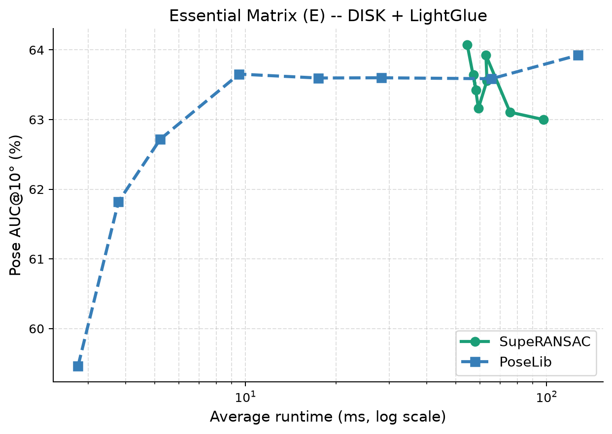</td>
    <td align="center">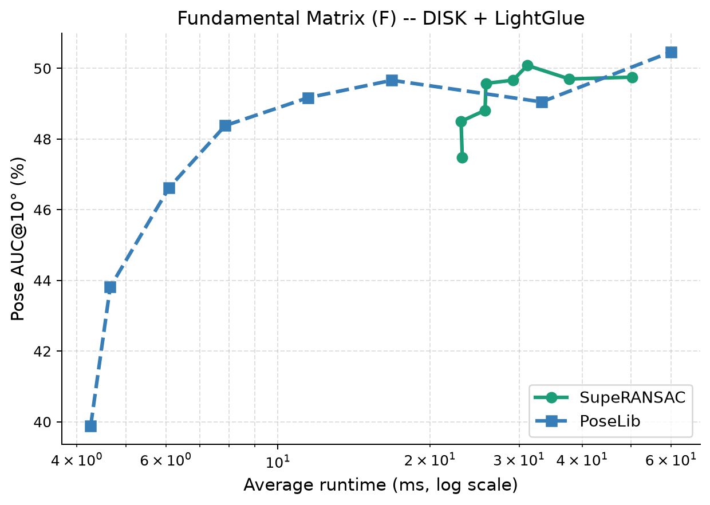</td>
    <td align="center">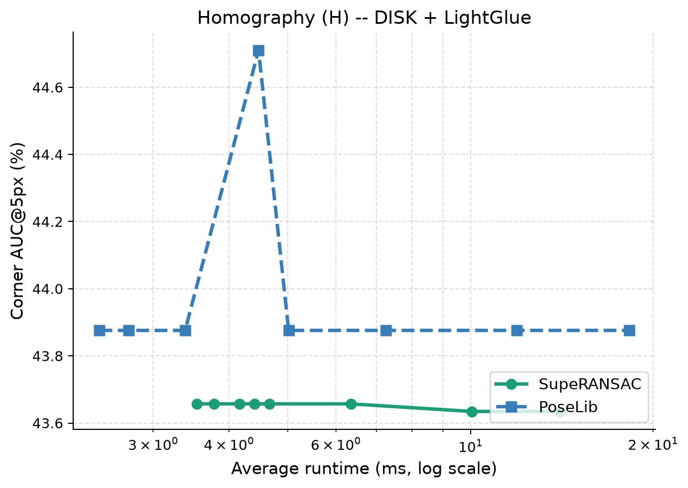</td>
  </tr>
  <tr>
    <td align="center">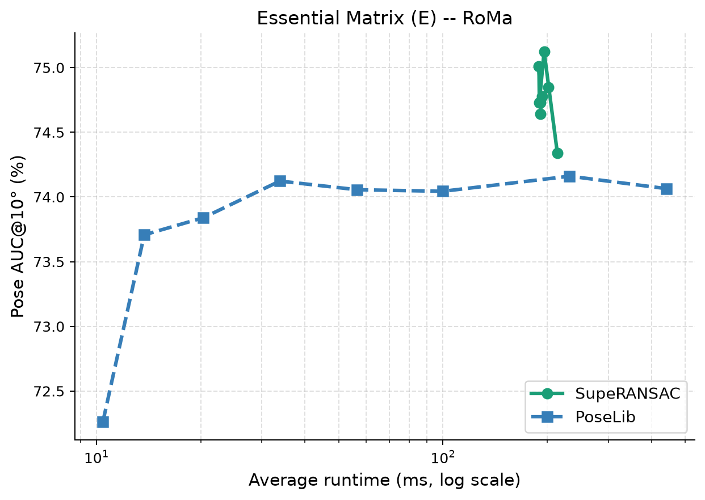</td>
    <td align="center">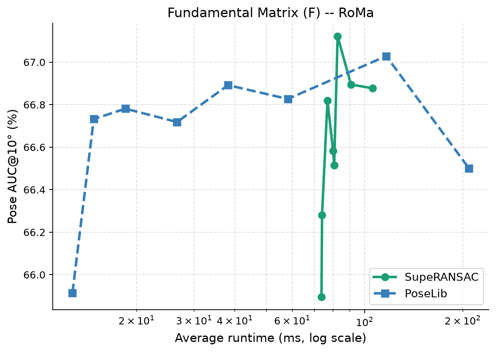</td>
    <td align="center">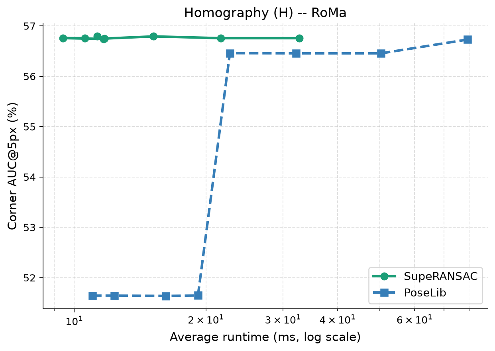</td>
  </tr>
  <tr>
    <td align="center">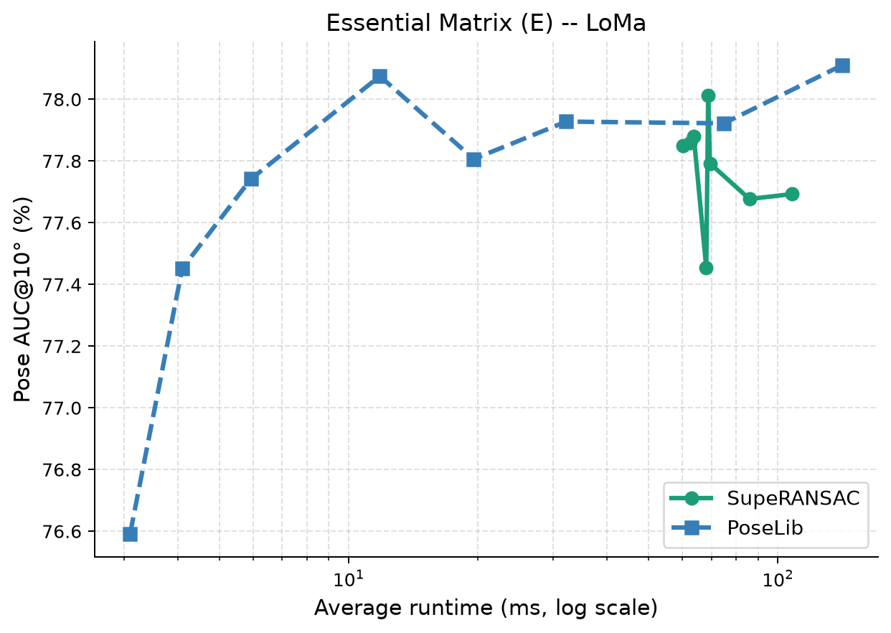</td>
    <td align="center">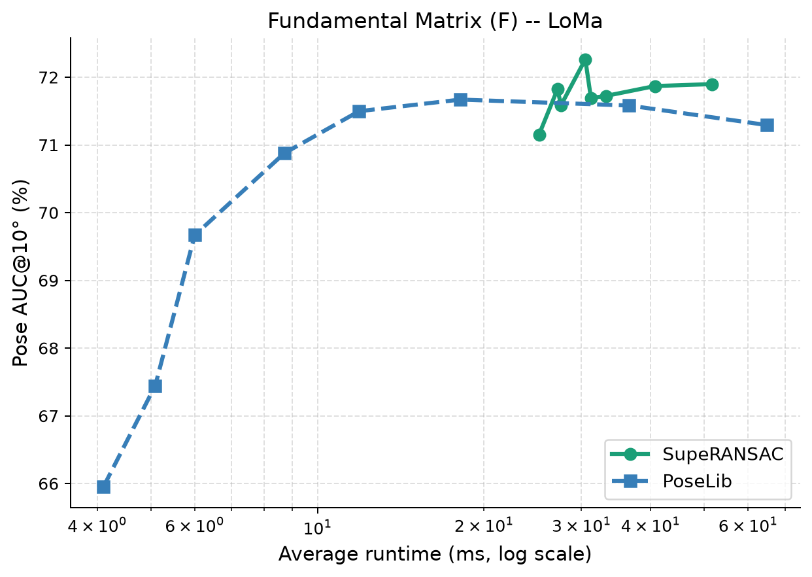</td>
    <td align="center">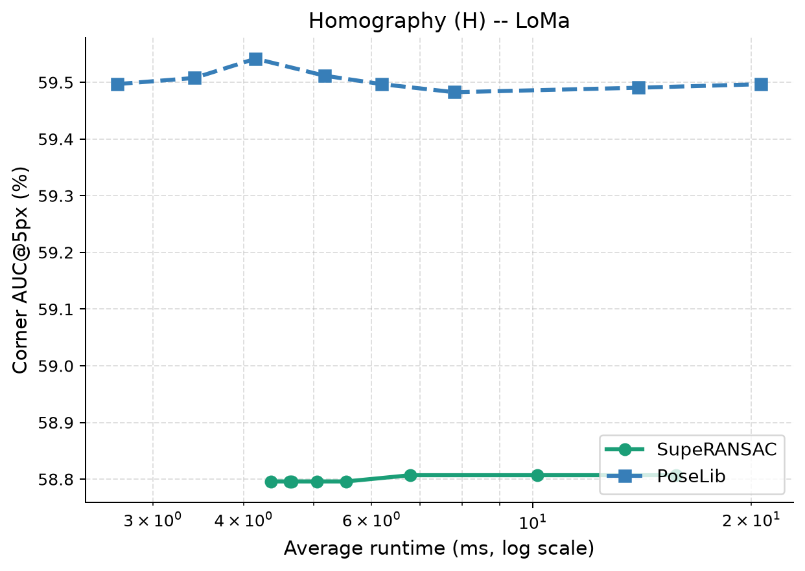</td>
  </tr>
  <tr>
    <td align="center"><b>Essential matrix</b></td>
    <td align="center"><b>Fundamental matrix</b></td>
    <td align="center"><b>Homography</b></td>
  </tr>
</table>

```bash
python tests/test_relative_pose.py --problem all --features all    # add --ablate_pp to also run F without the Plane-and-Parallax post-refinement
python tests/test_homography.py --features all
```

---

## 2. Seven feature matchers

Same 300 calibrated pairs (and the 16 planar pairs) with **LoMa**, **RoMa**, **LoFTR**, **DISK + LightGlue**, **RootSIFT**, **SIFT** and **ORB**. The classical matchers use a 0.95 ratio test on 4000 keypoints, so their match sets are large and noisy (typically 10–40 % inliers); the learned matchers deliver mostly clean sets.

<table align="center">
  <tr>
    <td align="center">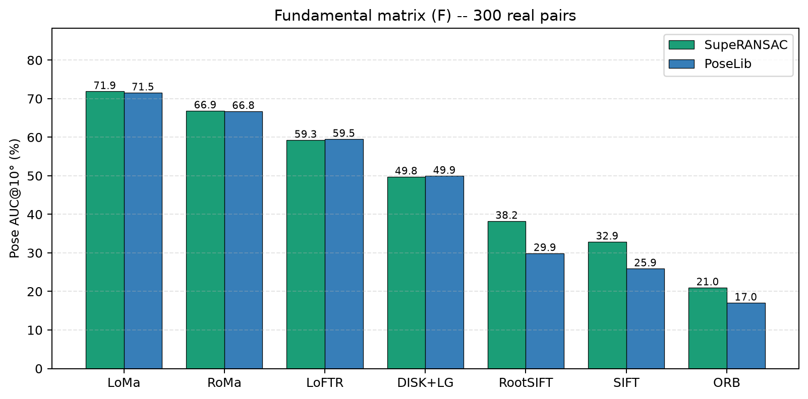</td>
    <td align="center">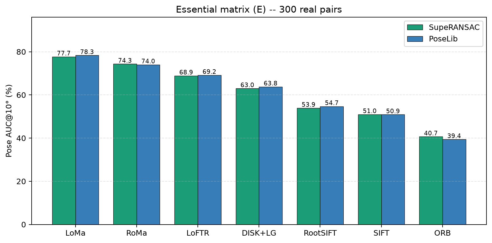</td>
  </tr>
  <tr>
    <td align="center" colspan="2">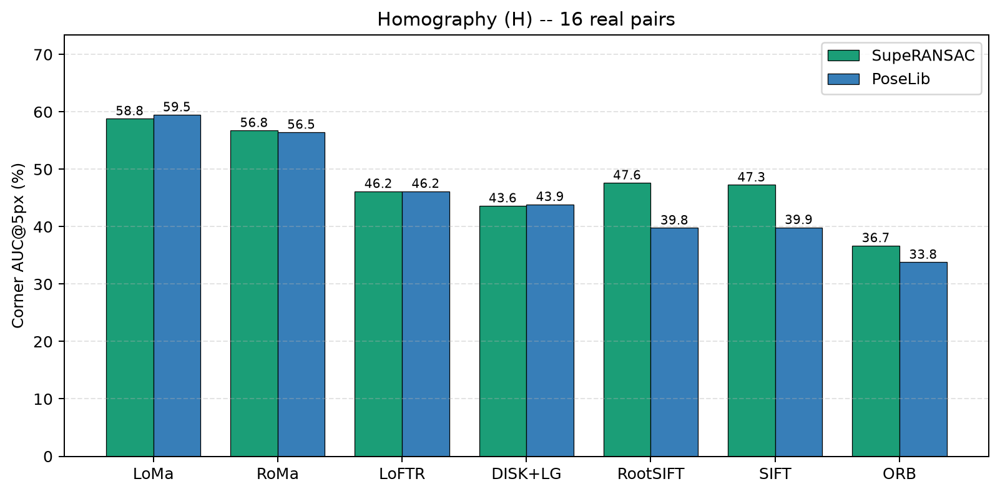</td>
  </tr>
</table>

| Matcher | $F$ AUC@10° PoseLib / SupeRANSAC | $E$ AUC@10° PoseLib / SupeRANSAC | $H$ AUC@5px PoseLib / SupeRANSAC |
|---|---:|---:|---:|
| LoMa | 71.5 / **71.9** (+0.4) | **78.3** / 77.7 (-0.6) | **59.5** / 58.8 (-0.7) |
| RoMa | 66.8 / **66.9** (+0.1) | 74.0 / **74.3** (+0.3) | 56.5 / **56.8** (+0.3) |
| LoFTR | **59.5** / 59.3 (-0.2) | **69.2** / 68.9 (-0.3) | **46.2** / 46.2 (-0.0) |
| DISK+LG | **49.9** / 49.8 (-0.2) | **63.8** / 63.0 (-0.8) | **43.9** / 43.6 (-0.2) |
| RootSIFT | 29.9 / **38.2** (+8.4) | **54.7** / 53.9 (-0.8) | 39.8 / **47.6** (+7.9) |
| SIFT | 25.9 / **32.9** (+7.0) | 50.9 / **51.0** (+0.1) | 39.9 / **47.3** (+7.4) |
| ORB | 17.0 / **21.0** (+4.0) | 39.4 / **40.7** (+1.2) | 33.8 / **36.7** (+2.9) |
| Average | 45.8 / **48.6** (+2.8) | **61.5** / 61.4 (-0.1) | 45.6 / **48.1** (+2.5) |

```bash
python tests/test_detectors.py --problem all
```

---

## 3. Classic labelled tentative correspondences (high outlier ratios)

The original SIFT tentative matches shipped with **kusvod2**, **AdelaideRMF / Multi-H** ($F$; 30 scenes, 5–94 % inliers, median 48 %) and **Homogr**, **EVD**, **AdelaideRMF / Multi-H planes** ($H$; 35 scenes, 2–49 % inliers, median 22 %). These files carry no confidence scores and are stored sorted by label, so every repeat shuffles them with a fixed seed and **both methods use uniform sampling**; 5 repeats per scene. $F$ error = mean Sampson error of the estimate on the labelled inliers; $H$ error = corner transfer error against the dataset homography.

<p align="center">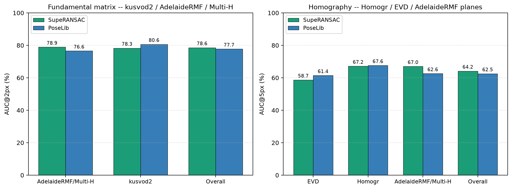</p>

| Problem | Scenes × repeats | Method | AUC@1px / 2px / 5px ($F$) — AUC@2.5 / 5 / 10 px ($H$) | Med err (px) | Mean ms |
|---|---:|---|---|---:|---:|
| $F$ AdelaideRMF/Multi-H | 19 × 5 | PoseLib | 55.1 / 76.6 / 90.6 | 0.34 | 30 |
| $F$ AdelaideRMF/Multi-H | 19 × 5 | SupeRANSAC | **57.8** / **78.9** / **91.6** | 0.33 | 59 |
| $F$ kusvod2 | 11 × 5 | PoseLib | 63.1 / **80.6** / **92.3** | 0.29 | 12 |
| $F$ kusvod2 | 11 × 5 | SupeRANSAC | **65.7** / 78.3 / 85.9 | 0.29 | 32 |
| $F$ **Overall** | 30 × 5 | PoseLib | 57.9 / 77.7 / **91.1** | 0.33 | 23 |
| $F$ **Overall** | 30 × 5 | SupeRANSAC | **60.5** / **78.6** / 89.4 | 0.32 | 49 |
| $H$ EVD | 11 × 5 | PoseLib | 38.5 / **61.4** / **80.7** | 1.73 | 2 |
| $H$ EVD | 11 × 5 | SupeRANSAC | **38.8** / 58.7 / 79.3 | 1.52 | 9 |
| $H$ Homogr | 5 × 5 | PoseLib | **38.5** / **67.6** / **83.8** | 1.55 | 2 |
| $H$ Homogr | 5 × 5 | SupeRANSAC | 38.4 / 67.2 / 83.6 | 1.57 | 7 |
| $H$ AdelaideRMF/Multi-H | 19 × 5 | PoseLib | 51.9 / 62.6 / 71.8 | 0.99 | 9 |
| $H$ AdelaideRMF/Multi-H | 19 × 5 | SupeRANSAC | **57.2** / **67.0** / **74.0** | 0.50 | 15 |
| $H$ **Overall** | 35 × 5 | PoseLib | 45.3 / 62.5 / 76.1 | 1.40 | 6 |
| $H$ **Overall** | 35 × 5 | SupeRANSAC | **48.3** / **64.2** / **76.8** | 1.10 | 12 |

```bash
python tests/test_classic_labelled.py
```

---

## 4. 6D absolute pose (PnP) and rigid registration

**Real data.** The 100 frozen 7Scenes pairs × 6 matchers (LoMa, RoMa, DISK+LG, RootSIFT, SIFT, ORB). Matches are lifted through the depth map of image 1 (and image 2 for 3D–3D); ground truth = the dataset pose files; the outliers are the matcher's own mismatches and depth noise. (7Scenes depth and colour are only approximately registered, which biases the GT slightly for all methods alike.) Error = max(rotation error, 0.5 × translation error in cm); AUC@(2°,4cm) / (5°,10cm) / (10°,20cm).

**Baselines.** PnP: PoseLib `estimate_absolute_pose` (LO-RANSAC + bundle adjustment) and `cv2.solvePnPRansac` (EPnP, plain RANSAC). Rigid: a 3-point Procrustes RANSAC with MSAC scoring, adaptive termination and a final least-squares fit on the inliers (`tests/test_6d_pose.py::procrustes_ransac`) — neither OpenCV nor PoseLib ships a rigid-registration RANSAC (`cv2.estimateAffine3D` fits a 12-DoF affine and is not comparable).

**Synthetic stress tests** (reported separately): `pose6dscene` with 33–91 % uniformly random 2D–3D outliers (140 problems) and `rigid_pose_example` with 70–92 % random 3D–3D outliers (50 problems) plus the shipped real scan pair.

<p align="center">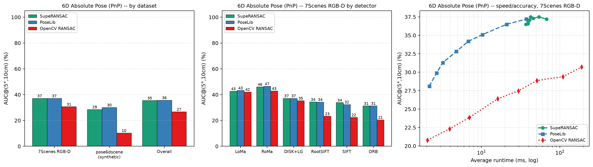</p>
<p align="center">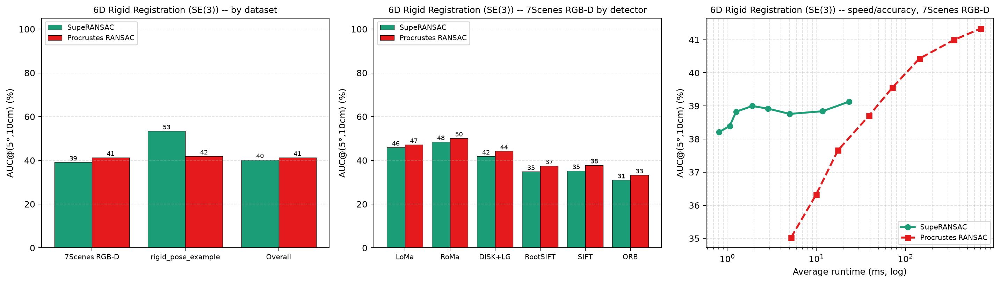</p>

| Problem | Data | Method | AUC@(2°,4cm) | AUC@(5°,10cm) | AUC@(10°,20cm) | Med rot / trans | Mean ms |
|---|---|---|---:|---:|---:|---:|---:|
| PnP | 7Scenes RGB-D, 600 | SupeRANSAC | 7.6 | **37.2** | **62.4** | 2.34° / 4.7 cm | 69 |
| PnP | 7Scenes RGB-D, 600 | PoseLib | **7.9** | 37.1 | 61.6 | 2.40° / 4.7 cm | 18 |
| PnP | 7Scenes RGB-D, 600 | OpenCV RANSAC | 5.4 | 30.7 | 53.7 | 2.84° / 5.8 cm | 191 |
| PnP | pose6dscene synthetic, 140 | SupeRANSAC | 8.4 | 28.6 | 50.4 | 1.40° / 8.8 cm | 52 |
| PnP | pose6dscene synthetic, 140 | PoseLib | **9.3** | **30.1** | **51.3** | 1.35° / 8.2 cm | 21 |
| PnP | pose6dscene synthetic, 140 | OpenCV RANSAC | 1.7 | 10.2 | 24.1 | 2.66° / 19.2 cm | 217 |
| Rigid | 7Scenes RGB-D, 599 | SupeRANSAC | 7.2 | 39.1 | 65.2 | 2.23° / 4.4 cm | 23 |
| Rigid | 7Scenes RGB-D, 599 | Procrustes RANSAC | **8.9** | **41.3** | **65.8** | 2.12° / 4.3 cm | 237 |
| Rigid | rigid_pose_example synthetic, 51 | SupeRANSAC | **1.3** | **53.4** | **75.7** | 2.27° / 4.2 cm | 21 |
| Rigid | rigid_pose_example synthetic, 51 | Procrustes RANSAC | 1.2 | 41.9 | 63.7 | 2.33° / 4.7 cm | 506 |

Per-matcher breakdowns on 7Scenes are printed by the script; on PnP, SupeRANSAC and PoseLib are within ±1 point for every matcher, and on rigid registration the Procrustes baseline is 1–3 points ahead of SupeRANSAC for every matcher while being 10× slower.

```bash
python tests/test_6d_pose.py --problem all
```

---

# Jupyter Notebook Examples

- **Homography Fitting with SuperPoint + LightGlue Matches**  
  Example available at: [notebook](examples/example_homography_fitting_splg.ipynb)

- **Homography Fitting with RoMA Matches**  
  Example available at: [notebook](examples/example_homography_fitting_roma.ipynb)

- **Fundamental Matrix Fitting with SuperPoint + LightGlue Matches**  
  Example available at: [notebook](examples/example_fundamental_matrix_fitting_splg.ipynb)

- **Fundamental Matrix Fitting with RoMA Matches**  
  Example available at: [notebook](examples/example_fundamental_matrix_fitting_roma.ipynb)

- **Essential Matrix Fitting with SuperPoint + LightGlue Matches**  
  Example available at: [notebook](examples/example_essential_matrix_fitting_splg.ipynb)

- **Essential Matrix Fitting with RoMA Matches**  
  Example available at: [notebook](examples/example_essential_matrix_fitting_roma.ipynb)

- **Absolute Pose Estimation**  
  Example available at: [notebook](examples/example_absolute_pose_fitting.ipynb)

- **6D Rigid Transformation Estimation**  
  Example available at: [notebook](examples/example_rigid_transform_fitting.ipynb)

---

## Usage

The library provides several model estimation functions and settings that allow customization of the RANSAC pipeline. `RANSACSettings()` is pre-configured with the best defaults for all estimators.

### Importing the Library

```python
import numpy as np
import pysuperansac
from pysuperansac import (
    ScoringType,
    SamplerType,
    LocalOptimizationType,
    InlierSelectorType,
    NeighborhoodType,
    CameraType,
    RANSACSettings,
)
```

### Example: Estimate a Homography, Fundamental, or Essential Matrix

```python
# Correspondences as an (N, 4) float64 array: [x1, y1, x2, y2], sorted by descending confidence
correspondences = np.array([
    [x1, y1, x2, y2],
    [x3, y3, x4, y4],
    # ...
], dtype=np.float64)
probabilities = np.ones(len(correspondences), dtype=np.float64)
image_sizes = [height1, width1, height2, width2]

# Default RANSACSettings() uses the best configuration automatically
config = RANSACSettings()

# Estimate Homography
H, inliers, score, iterations = pysuperansac.estimateHomography(
    correspondences, image_sizes, probabilities, config=config
)

# Estimate Fundamental Matrix
F, inliers, score, iterations = pysuperansac.estimateFundamentalMatrix(
    correspondences, image_sizes, probabilities, config=config
)

# Estimate Essential Matrix
E, inliers, score, iterations = pysuperansac.estimateEssentialMatrix(
    correspondences, K1, K2, image_sizes, probabilities, config=config
)
```

### Supported Estimation Functions

#### 1. Homography Estimation
- **Function**: `pysuperansac.estimateHomography(correspondences, image_sizes, probabilities=[], config=RANSACSettings())`
- **Description**: Estimates a $3 \times 3$ homography matrix from 2D-2D point correspondences.
- **Parameters**:
  - `correspondences`: `(N, 4)` `np.ndarray` (`[x1, y1, x2, y2]`).
  - `image_sizes`: `[height_src, width_src, height_dst, width_dst]`.
  - `probabilities` *(optional)*: Length-`N` list/array of prior match confidences.
  - `config`: An instance of `RANSACSettings`.

#### 2. Fundamental Matrix Estimation
- **Function**: `pysuperansac.estimateFundamentalMatrix(correspondences, image_sizes, probabilities=[], config=RANSACSettings())`
- **Description**: Estimates a $3 \times 3$ fundamental matrix from 2D-2D point correspondences with DEGENSAC and Plane-and-Parallax support.
- **Parameters**:
  - `correspondences`: `(N, 4)` `np.ndarray` (`[x1, y1, x2, y2]`).
  - `image_sizes`: `[height_src, width_src, height_dst, width_dst]`.
  - `probabilities` *(optional)*: Length-`N` list/array of prior match confidences.
  - `config`: An instance of `RANSACSettings`.

#### 3. Essential Matrix Estimation
- **Function**: `pysuperansac.estimateEssentialMatrix(correspondences, intrinsics_src, intrinsics_dst, image_sizes, probabilities=[], config=RANSACSettings())`
- **Description**: Estimates a $3 \times 3$ essential matrix using 2D-2D point correspondences and camera intrinsic matrices.
- **Parameters**:
  - `correspondences`: `(N, 4)` `np.ndarray` (`[x1, y1, x2, y2]`).
  - `intrinsics_src`: $3 \times 3$ source camera intrinsic matrix.
  - `intrinsics_dst`: $3 \times 3$ destination camera intrinsic matrix.
  - `image_sizes`: `[height_src, width_src, height_dst, width_dst]`.
  - `probabilities` *(optional)*: Length-`N` list/array of prior match confidences.
  - `config`: An instance of `RANSACSettings`.

#### 4. Rigid Transformation Estimation
- **Function**: `pysuperansac.estimateRigidTransform(correspondences, bounding_box_sizes, probabilities=[], config=RANSACSettings())`
- **Description**: Estimates a $4 \times 4$ 6D rigid transformation matrix from 3D-3D point correspondences.
- **Parameters**:
  - `correspondences`: `(N, 6)` `np.ndarray` (`[X1, Y1, Z1, X2, Y2, Z2]`).
  - `bounding_box_sizes`: `[max_x1, max_y1, max_z1, max_x2, max_y2, max_z2]`.
  - `probabilities` *(optional)*: Length-`N` list/array of prior match confidences.
  - `config`: An instance of `RANSACSettings`.

#### 5. Absolute Pose Estimation
- **Function**: `pysuperansac.estimateAbsolutePose(correspondences, camera_type, camera_params, bounding_box, probabilities=[], config=RANSACSettings())`
- **Description**: Estimates the 6D absolute pose $(R, t)$ of a camera from 2D-3D correspondences.
- **Parameters**:
  - `correspondences`: `(N, 5)` `np.ndarray` (`[u, v, X, Y, Z]`).
  - `camera_type`: Type of the camera (e.g., `CameraType.SimpleRadial`, `CameraType.SimplePinhole`).
  - `camera_params`: Camera intrinsic/distortion parameters.
  - `bounding_box`: `[height, width, max_X, max_Y, max_Z]`.
  - `probabilities` *(optional)*: Length-`N` list/array of prior match confidences.
  - `config`: An instance of `RANSACSettings`.

### Advanced Configuration: `RANSACSettings`

The `RANSACSettings` class provides fine-grained control over the RANSAC pipeline (shown below with the default values):

```python
config = RANSACSettings()
config.min_iterations = 1000
config.max_iterations = 5000
config.inlier_threshold = 1.5
config.confidence = 0.999999
config.scoring = ScoringType.MAGSAC
config.sampler = SamplerType.PROSAC
config.local_optimization = LocalOptimizationType.GCRANSAC
config.final_optimization = LocalOptimizationType.LSQ
config.neighborhood = NeighborhoodType.Grid
```

### Enumerations and Their Values

**Scoring Types**
- `ScoringType.RANSAC`
- `ScoringType.MSAC`
- `ScoringType.MAGSAC`
- `ScoringType.ACRANSAC`
- `ScoringType.GRID`

**Sampler Types**
- `SamplerType.Uniform`
- `SamplerType.PROSAC`
- `SamplerType.NAPSAC`
- `SamplerType.ProgressiveNAPSAC`
- `SamplerType.ImportanceSampler`
- `SamplerType.ARSampler`

**Local Optimization Types**
- `LocalOptimizationType.Nothing`
- `LocalOptimizationType.LSQ`
- `LocalOptimizationType.IRLS`
- `LocalOptimizationType.NestedRANSAC`
- `LocalOptimizationType.GCRANSAC`
- `LocalOptimizationType.IteratedLM`

**Neighborhood Types**
- `NeighborhoodType.Grid`
- `NeighborhoodType.FLANN_KNN`
- `NeighborhoodType.FLANN_Radius`
- `NeighborhoodType.BruteForce`

**Camera Types**
- `CameraType.SimpleRadial`
- `CameraType.SimplePinhole`

---

## Evaluation - Python

All evaluation scripts are self-contained and live in `tests/`. They print Markdown tables, write JSON results to `data/`, and regenerate the figures in `assets/`.

1. **Download the public datasets** (PhotoTourism tutorial scene, ETH3D, 7Scenes, kusvod2 / AdelaideRMF / Multi-H / Homogr / EVD; HPatches optional):
   ```bash
   python tests/download_datasets.py --dataset all
   ```
2. **Relative pose** ($F$ and $E$) on the 300 frozen calibrated pairs:
   ```bash
   python tests/test_relative_pose.py --problem all --features all          # LoMa, RoMa, DISK+LG
   python tests/test_relative_pose.py --problem fundamental --dataset eth3d --features LoMa
   python tests/test_relative_pose.py --problem fundamental --ablate_pp     # F with/without Plane-and-Parallax post-refinement
   ```
3. **Homography** on Homogr + EVD (+ HPatches if downloaded):
   ```bash
   python tests/test_homography.py --features all
   ```
4. **Seven matchers** (LoMa, RoMa, LoFTR, DISK+LG, RootSIFT, SIFT, ORB) on the same pairs:
   ```bash
   python tests/test_detectors.py --problem all
   ```
5. **Classic labelled tentative matches** (kusvod2, AdelaideRMF / Multi-H, Homogr, EVD):
   ```bash
   python tests/test_classic_labelled.py
   ```
6. **6D absolute pose and rigid registration** (7Scenes RGB-D + synthetic stress tests):
   ```bash
   python tests/test_6d_pose.py --problem all
   ```

Feature matches are cached in `data/multi_detector_cache.pkl`; the first run extracts them (CPU, roughly 1 s per pair and matcher).

### Install Feature Detectors

To use **LoMa** ([ECCV 2026 Oral] *LoMa: Local Feature Matching Revisited*):
```bash
git clone https://github.com/davnords/LoMa.git && cd LoMa
pip install -e .
```

To use **SuperPoint / DISK + LightGlue** or **LoFTR** features, install `kornia` / `LightGlue`:
```bash
pip install kornia
git clone https://github.com/cvg/LightGlue.git && cd LightGlue
python -m pip install -e .
```

To use **RoMa** features:
```bash
git clone https://github.com/Parskatt/RoMa && cd RoMa
pip install -e .
```

